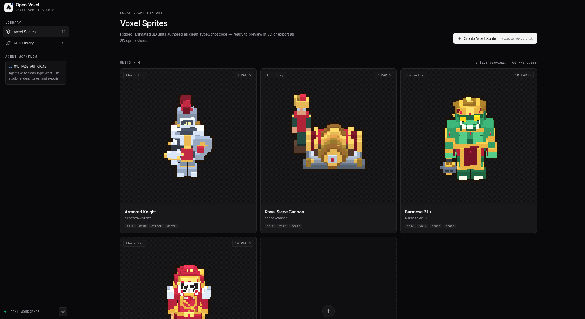
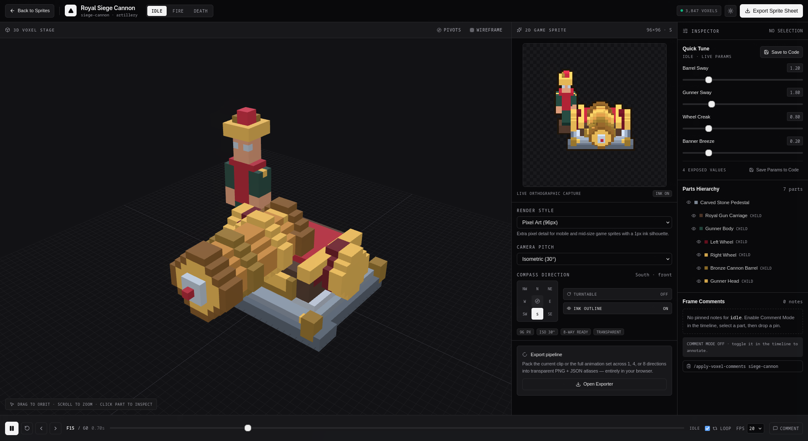

# Open-Voxel

Open-Voxel is an agent-native local studio for building rigged 3D voxel units, deterministic animation and VFX, and transparent 2D sprite sheets — all from clean TypeScript source files.

There is no asset editor and no painted-frame pipeline. A coding agent authors code; the browser renders it live in 3D, captures it through an orthographic game camera, and packs the result into a PNG + JSON atlas in the browser.

## Showcase

### Home Dashboard



### Studio



## Features

- **Code-authored voxel units** with nested parts, absolute pivots, palettes, and per-clip parameters.
- **Interactive 3D stage** with OrbitControls, part selection, hierarchy visibility, pivot gizmos, wireframe mode, and frame-comment pins.
- **Live 2D game-sprite preview** with 64/96/128px pixel-art and 256px cel-shaded styles, isometric/oblique/side cameras, 8 compass directions, and ink outlines.
- **Deterministic animation** driven by frame numbers and seeded math, not physics or random state.
- **Deterministic voxel VFX** for muzzle blasts, smoke, slash arcs, shockwaves, and electric arcs.
- **Frame comments** pinned into `unit.ts` for an agent to apply in a later pass.
- **Sprite-sheet export** for the current clip or every clip, at 1/4/8 directions, as a transparent PNG plus TexturePacker-style atlas JSON.
- **Runtime filesystem tools** in the Vite dev server for saving tuned params, deleting parts, deleting units, and storing comments.
- Light and dark themes with a persisted preference.

## Quick Start

Requires Node.js 20 or newer.

```bash
npm install
npm run dev
```

Open the printed local URL (defaults to `http://127.0.0.1:5173`).

Other commands:

```bash
npm run typecheck
npm run build
npm run preview
```

`npm run build` runs `tsc --noEmit` before Vite bundles. `preview` serves a static build, so the filesystem-backed `/api/*` routes are only available while using `npm run dev`.

## Using the Studio

### Home Dashboard

- **Voxel Sprites** lists every registered unit with an animated live preview.
- **VFX Library** previews the deterministic effects available in `src/engine/voxelVfx.ts`.
- **Create Voxel Sprite** and **Create Voxel VFX** build copyable slash commands for an agent.
- The trash action deletes a unit folder and unregisters it from `src/units/index.ts`.

### Unit Studio

```
/?unit=armored-knight&anim=idle
```

- **3D stage** — orbit, zoom, click a part to inspect it. Toggle pivot joints and wireframe.
- **2D sprite** — switch render style, camera pitch, compass direction, ink outline, and auto turntable.
- **Inspector** — tune exposed clip params, save them back to source, show/hide or delete parts, and read pinned comments.
- **Timeline** — play/pause, scrub, step frames, loop, change FPS, and enable comment mode.
- **Export Sprite Sheet** — choose clips, directions, resolution, and download PNG + JSON.

## Authoring Model

A unit lives at `src/units/<unit-id>/unit.ts` and exports a `VoxelUnitDefinition`.

```ts
export const myUnit: VoxelUnitDefinition = {
  id: 'my-unit',
  name: 'My Unit',
  category: 'character',
  palette: { iron: '#778394' },
  parts: [
    part('torso', 'Torso', [0, 16, 0])
      .fillBox(-3, 14, -2, 3, 22, 2, '#778394')
      .end(),
  ],
  animations: [
    {
      id: 'idle',
      name: 'Idle',
      frames: 32,
      fps: 24,
      loop: true,
      params: {},
      evaluate: (frame, totalFrames, params) => ({ parts: {} }),
    },
  ],
};
```

After creating a unit, add it to the registry in `src/units/index.ts`:

```ts
import { myUnit } from './my-unit/unit';

export const unitRegistry: VoxelUnitDefinition[] = [
  armoredKnight,
  siegeCannon,
  myUnit,
];
```

### Coordinate Policy

- Voxel coordinates are **absolute model-space** coordinates.
- A part pivot is also **absolute model-space**.
- `VoxelSceneRig` subtracts the pivot from each voxel internally, places the part group at the pivot relative to its parent, and nests groups. Parent rotations carry child positions and children correctly.
- Animation transforms are deltas from the authored rest pose. Rotation values are radians; translation values are voxel units.

### Parts and Pivots

```ts
part('head', 'Helmet', [0, 26, 0], 'torso')
  .fillBox(-3, 26, -3, 3, 30, 3, '#3b4452')
  .end();
```

- `id` must be unique and stable. Animation results and comments address parts by ID.
- `parentId` is optional. Use a parent joint when a limb should carry children.
- Put the pivot at the actual hinge, shoulder, hip, barrel trunnion, or rotation center.

### Builder API

From `src/engine/voxelBuilder.ts`:

- `part(id, name, pivot, parentId?)` — start a part builder.
- `.fillBox(x1, y1, z1, x2, y2, z2, color)` — inclusive box fill.
- `.fillSphere(cx, cy, cz, radius, color)`
- `.fillCylinder(cx, y1, y2, cz, radius, color, axis)`
- `.setVoxel(x, y, z, color)`
- `.carveBox(...)`, `.mirrorX()`, `.translate(dx, dy, dz)`
- `.extrude(grid2D, paletteMap, depth)`
- `.add(...voxels)`, `.build()`, `.end()`

Standalone helpers include `translateVoxels`, `dedupeVoxels`, `fillBox`, `fillSphere`, `fillCylinder`, `carveBox`, `mirrorX`, and `extrudePattern`.

### Animation

Animation `evaluate(frame, totalFrames, params)` returns:

```ts
{
  parts: {
    torso: { rx: 0, ry: 0.2, rz: 0, tx: 0, ty: 0.3, tz: 0, scale: 1, visible: true },
  },
  vfx: [{ x: 0, y: 18, z: 4, color: '#fbbf24', size: 0.5, opacity: 0.9 }],
}
```

Shared motion helpers in `src/engine/animationPresets.ts`:

- `humanoidIdle`, `humanoidWalk`, `meleeSlash`, `artilleryFire`, `voxelShatterDeath`
- `deg`, `clamp`, `lerp`, `easeInOut`, `easeOut`, `param`
- `mergeTransforms`, `mergeVfx`

Meaningful numeric controls should be exposed in `clip.params` with `label`, `value`, `min`, `max`, and optional `step`. The Inspector edits those values and **Save to Code** rewrites the `value` literals in the source file.

### Deterministic VFX

VFX functions return arrays of `VoxelVfxParticle` based only on progress, seeds, and math:

- `spawnMuzzleBlastVoxels(origin, direction, progress, seed?, scale?)`
- `spawnSmokeCloudVoxels(origin, progress, seed?, scale?)`
- `spawnSlashArcVoxels(origin, angle, progress, scale?)`
- `spawnShockwaveRingVoxels(origin, radius, progress, scale?)`
- `spawnElectricArcsVoxels(origin, progress, seed?, scale?)`

Catalog entries live in `src/engine/vfxCatalog.ts`. Add a matching entry if you want the effect to appear in the VFX Library.

## Sprite Capture and Export

`src/engine/pixelRenderer.ts` renders the same `VoxelSceneRig` through a transparent orthographic camera:

- Directions: `S, SW, W, NW, N, NE, E, SE`
- Pitches: isometric 30°, top-down oblique 45°, side 0°
- Styles: 64/96/128px pixel art with 1px ink; 256px cel shading with 2px ink
- Pixel-art frames use a crisp alpha threshold and nearest-neighbor capture
- The outliner adds a dark transparent silhouette before the frame is drawn to the sheet
- Export packs rows by clip × direction and columns by frame
- Atlas JSON includes per-frame rects, pivots, clip/direction metadata, and named animation arrays

Exports happen entirely in the browser. No server-side image tooling is used.

## Comments

Frame comments are appended to the unit source as annotations:

```ts
// @voxel-comment {"id":"vc_...","unitId":"armored-knight","clipId":"walk","frame":12,"partId":"left_leg","text":"Lift the knee higher"}
```

Use **Comment Mode** in the timeline, select a part if desired, and pin a note. The Inspector shows notes for the active clip and copies the command:

```text
/apply-voxel-comments armored-knight
```

Agents should update the requested frames and remove resolved comment lines. See `.agents/skills/apply-voxel-comments/SKILL.md`.

## Runtime Filesystem API

Implemented by the Vite plugin in `vite.config.ts`:

| Method | Path | Purpose |
| --- | --- | --- |
| `GET` | `/api/health` | Health check |
| `GET` | `/api/units/:id/comments` | Read comments from `unit.ts` |
| `POST` | `/api/units/:id/comments` | Append a comment annotation |
| `POST` | `/api/units/:id/clips/:clipId/params` | Rewrite numeric param `value`s |
| `DELETE` | `/api/units/:id/parts/:partId` | Remove a part object from the parts array |
| `DELETE` | `/api/units/:id` | Delete the unit folder and registry entry |

Writes target source files directly. Use version control. The API is development-only and validates unit/part IDs against a safe slug pattern.

## Project Structure

```text
src/
  engine/
    animationPresets.ts   Shared motion functions and math helpers
    pixelRenderer.ts      Orthographic sprite capture and sheet packing
    renderStyles.ts       Pixel/cel render style catalog
    voxelBuilder.ts       Voxel construction helpers
    voxelScene.ts         Three.js rig shared by 3D and 2D renderers
    voxelVfx.ts           Deterministic particle generators
    vfxCatalog.ts         VFX Library entries
  units/
    index.ts              Static unit registry
    armored-knight/        Starter character
    siege-cannon/          Starter artillery unit
  components/             Dashboard, studio, inspector, timeline, export UI
  types/voxel.ts          Shared contracts
  utils/                  Theme, API client, helpers
vite.config.ts            App config + filesystem API plugin
```

## Agent Skills

The same four skills are mirrored for common agent runtimes:

- `.agents/skills/`
- `.claude/skills/`
- `.opencode/skills/`

Skills:

- `create-voxel-unit` — author and register a new rigged unit.
- `animate-voxel` — add or refine animation clips and tunable params.
- `create-voxel-vfx` — add deterministic effects and catalog entries.
- `apply-voxel-comments` — resolve pinned frame notes.

## Design Constraints

- Keep geometry and motion deterministic; do not use `Math.random()` in unit or VFX evaluation.
- Prefer readable TypeScript over generated binary assets.
- Do not introduce Python/ImageMagick sprite-processing dependencies.
- Keep the UI minimal and restrained, with crisp hairlines and no brown/coffee theme colors.
- Run `npm run typecheck` after source changes.
